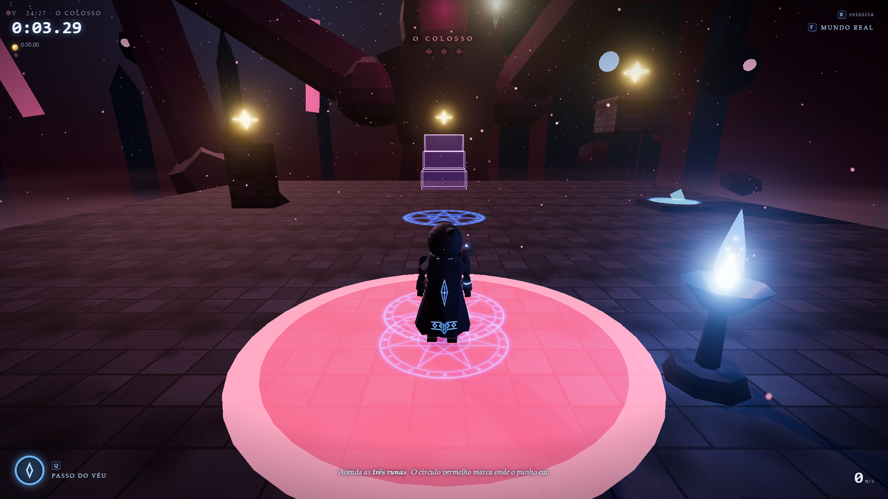

# VEIL  ·  v1.3



Parkour místico em terceira pessoa. Um andarilho encapuzado acorda nas ruínas
da Abadia Submersa, sem memória, e atravessa 39 fases em 7 capítulos para
costurar o Véu que ele mesmo rasgou.

Feito com **Three.js + Vite**, sem modelos, texturas ou sons externos: toda a
geometria, os materiais (texturas desenhadas em canvas) e o áudio (WebAudio)
são gerados por código.

Para publicar (itch.io / GitHub Pages) veja [PUBLICAR.md](PUBLICAR.md); as novidades estão em
[CHANGELOG.md](CHANGELOG.md) e as imagens de divulgação em [press/](press/).

## Como rodar

```bash
npm install
npm run dev      # abre em http://localhost:5173
npm run build    # gera a versão de produção em dist/
```

Clique na tela para começar. O mouse fica preso à janela (Pointer Lock);
`Esc` pausa e libera o cursor. Também funciona com controle (Xbox/PlayStation).

## Controles

| Teclado | Controle | Ação |
| --- | --- | --- |
| `W A S D` + mouse | analógicos | mover / câmera |
| `Espaço` | A / ✕ | saltar (segurar vai mais alto) · pulo na parede · salto da parede |
| `Q` | X / □ · RB | **Passo do Véu** (avanço; uma vez no ar) |
| `C` | B / ○ · LT | correndo: **deslizar** · parado: esgueirar/engatinhar |
| `E` (segurar) | LB · RT | **Gancho do Véu** nas âncoras de luz · **Fio de Luz** |
| `F` | Y / △ | **atravessar para o outro lado** do Véu |
| `Shift` | analógico leve | andar |
| `R` | Back | reiniciar a fase |
| `V` | R3 | primeira / terceira pessoa |
| `Esc` / `P` | Start | pausa |

Os menus também são navegáveis pelas setas + `Enter` ou pelo controle. Todas as teclas podem ser
trocadas em **Opções → Teclas**.

## A história

Entre o mundo dos vivos e o dos mortos existe o Véu. O andarilho era aprendiz
dos monges da Abadia; quando a irmã dele, Lira, morreu, ele usou o Artefato
para abrir uma fresta no Véu — e o rasgou. Os monges viraram os Guardiões, o
Abade virou o Colosso, e o andarilho esqueceu tudo. Cada fase tem um
**fragmento de memória** escondido (◆) que conta um pedaço dessa história
(tela **Memórias**). O final tem um epílogo.

A história também acontece enquanto você corre: cada capítulo abre com um
interlúdio, e no meio das fases falam as **vozes** — Lira, o Abade, a
Sombra, as almas do Comboio e os pensamentos do próprio andarilho. Cada
capítulo tem seu clima (cinza, chuva com relâmpagos, brasas, pólen) e seus
sons de fundo (sinos, apito do trem fantasma, sussurros, um coração).

## Capítulos e fases

| Capítulo | Fases |
| --- | --- |
| I — O Despertar | Despertar · Saltos de Fé · Lâminas do Véu · Corredor do Véu · Desabamento · chefe **O Sineiro** |
| II — A Ferrovia dos Mortos | Comboio Espectral · Travessia · Tempestade · Fuga · chefe **A Locomotiva** |
| III — Céu Partido | Engrenagens · Torre da Maré · Céu Partido · Fendas · Âncoras de Luz · Ventos Uivantes · **Ondas de Luz** (surf) · chefe **O Vendaval** |
| IV — O Outro Lado | Respiração · O Outro Lado · A Sombra · Fundo do Mundo · **Labirinto de Runas** · chefe **O Reflexo** |
| V — O Coração do Véu | Abadia Submersa (stealth) · Coração do Véu · **O Colosso** (luta final) |
| VI — Além do Véu | **Crista Partida** (surf difícil) · **Tempestade de Âncoras** · **Prova do Tecelão** (todas as mecânicas) · chefe **O Eclipse** |
| VII — Os Fios de Lira | **Muros de Lira** · **Fios de Luz** · **Zigue-Zague** · **O Tear do Céu** · **Pega-Pega** (com a Sombra) · **O Último Fio** · chefe **A Traça** |

Cada capítulo termina num chefe com mecânica própria (ondas do sino, luta em
cima do trem, vento, os dois mundos, luz e escuridão, muros que somem).

O capítulo VII abre ao derrotar o Colosso: são os caminhos que Lira corria
quando criança, com corrida na parede e Fios de Luz.

Cada fase tem medalhas de ouro, prata e bronze por tempo, além de desafios:
terminar sem morrer (✝), sem usar o Passo do Véu (◇) e achar o fragmento (◆).

## Mecânicas

- **Movimento**: corrida rápida, controle aéreo que preserva o embalo, coyote
  time, buffer de salto, pulo na parede, agarrar e escalar bordas e rolamento
  ao cair de muito alto correndo.
- **Deslizar**: `C` correndo dá um impulso rente ao chão por baixo de barras
  corrompidas e passagens baixas. Pular no meio do deslize mantém a velocidade.
  Parado, `C` agacha e também cabe nas passagens.
- **Gancho do Véu**: perto de uma âncora de luz (ela brilha e aparece
  "E gancho"), segure `E` para balançar. A corda recolhe sozinha; solte no alto
  do arco (ou aperte `Espaço`) para se lançar.
- **Correntes de vento**: colunas que levantam, vento lateral que empurra no
  ar e vento contra.
- **Plataformas de ritmo**: pontes de luz que existem só em parte do ciclo e
  piscam antes de sumir.
- **O outro lado (`F`)**: alguns blocos só existem num dos dois mundos; os
  contornos mostram o que há do outro lado. Dá para trocar no ar.
- **A Sombra**: um eco escuro refaz o seu caminho segundos depois — parar é morrer.
- **Surf** (como no CS): rampas íngremes de luz sem atrito. Caia numa face e
  segure a direção **contra** a rampa (`A`/`D`) — a gravidade dá a velocidade
  (passa de 40 m/s). `Espaço` salta para fora da rampa. Há barras sobre as
  cristas e rampas que só existem do outro lado do Véu.
- **Corrida na parede** (muros dourados): no ar, encoste de lado num muro
  rúnico e segure para frente. A gravidade volta aos poucos; `Espaço` salta
  para o muro da frente e cada salto emendado acelera (zigue-zague).
- **Fios de Luz**: perto de um fio, segure `E` para deslizar pendurado. A
  descida acelera (até 22 m/s), a subida freia e o fim do fio lança você.
  Segurando `E` no ar, o andarilho agarra o próximo fio sozinho.
- **Fluxo**: emendar movimentos sem parar no chão (paredes, fios, gancho,
  trampolins, anéis, surf, barreiras do Véu, troca de mundo no ar) monta uma
  sequência — contador no HUD, um sino cada vez mais agudo e o maior Fluxo no
  fim da fase.
- **Runas e portões**: tocar uma runa abre portões, alguns só por segundos.
- **O Colosso**: o punho cai onde está o círculo vermelho (depois vira chão);
  o braço varre a arena baixo (pule) ou alto (deslize). Acenda as três runas.
- **Pontos de controle** nas fases longas: morrer volta ao último braseiro
  aceso (o tempo continua); `R` reinicia a fase inteira.
- **Passo do Véu**: avanço curto que atravessa membranas do Véu e recarrega em
  cristais e anéis.
- **Stealth (Abadia)**: guardiões com visão, audição e suspeita; o Passo do Véu
  faz barulho.
- Ainda: carruagens espectrais, lâminas, pedras que desabam, trampolins,
  anéis de impulso, maré e muro do Véu.

## Extras

- **Andarilho**: 14 mantos desbloqueados por feitos, que mudam também a forma
  (capuz pontudo/redondo, chifres, coroa, máscara, ombreiras, armadura,
  estampas da capa: runas, estrelas, chamas, penas, listras) e o tamanho da
  capa. A tela do Andarilho tem prévia das animações (parado, marcha,
  corrida, salto, surf, deslize, gancho, esgueirar).
- **Personagem**: esqueleto com quadril, tronco, cabeça, cotovelos e joelhos;
  marcha e corrida com balanço do quadril e do tronco, inclinação nas curvas,
  cambalhota ao saltar rápido, giro no pulo na parede, rolamento, pose de
  surf, corpo alinhado à corda no gancho, olhar em volta parado. Capa e
  cachecol são tecido simulado com colisão contra o corpo, e há um rastro de
  luz em alta velocidade.
- **Fantasma do recorde**: o seu melhor tempo corre junto como um vulto azul.
- **Modo Speedrun**: todas as fases seguidas, um cronômetro só (libera ao
  concluir todas).
- **Opções**: sensibilidade (mouse e controle), inverter Y, campo de visão,
  volume geral e música, qualidade gráfica (para PCs fracos), velocidade do
  jogo (assistência), fantasma, tremor de câmera e dicas.
- Câmera lenta curta em anéis e fragmentos, capa e cachecol com física,
  olhos e runas da capa que acendem conforme a carga do Véu.

## Estrutura

```
src/
  main.js              ponto de entrada
  game.js              estados do jogo, fases, speedrun, fragmentos, mundos, final
  scene.js             renderizador, céu, névoa, ambientes (inclusive o outro lado), bloom, MSAA
  lights.js            luzes pontuais em vagas fixas (os shaders nunca recompilam)
  materials.js         texturas procedurais e materiais
  physics.js           mundo de colisão (AABB), raycast, chão
  player.js            andarilho: física (movimento, deslize, gancho, vento, surf,
                       corrida na parede, Fios de Luz)
  character.js         andarilho: modelo, acessórios, tecido e animações
  skins.js             mantos e regras de desbloqueio
  echo.js              fantasma do recorde (gravação) e a Sombra
  lore.js              capítulos, frases das fases, memórias e epílogo
  cameraController.js  câmera em terceira pessoa com colisão (mouse e analógico)
  veilStep.js          o Passo do Véu (recarga, rastro, eco, barreiras)
  guardian.js          IA dos guardiões, percepção e visual
  levels/
    index.js           lista de fases e capítulos
    builder.js         construtor de fases e todos os elementos dinâmicos
    runs.js            fases de corrida originais
    mechanics.js       fases das mecânicas novas
    surf.js            surf
    trials.js          fases combinadas, provas do capítulo VI e o Colosso
    lira.js            capítulo VII: muros rúnicos e Fios de Luz
    liraRoutes.js      as rotas da Lira (guia) no capítulo VII
    bosses.js          os chefes dos capítulos I, II, III, IV, VI e VII
    abbey.js           a Abadia Submersa (stealth)
  effects.js           partículas, imagens residuais (instanciadas), anéis de eco
  settings.js          opções salvas
  ui.js / style.css    interface (HUD, telas, menus)
  input.js             teclado, mouse (Pointer Lock) e controle (Gamepad API)
  audio.js             sons e trilha sintetizados
```

Em modo de desenvolvimento há atalhos pela URL: `?play=<id da fase>`,
`?screen=select|wardrobe|memories|options`, `?skin=<id>`, `?anim=<pose>`, `?pos=x,y,z`, `?intro=1`, `?ff=<segundos>` (avança a simulação) e `?clean=1` (título sem botões, para capas).
